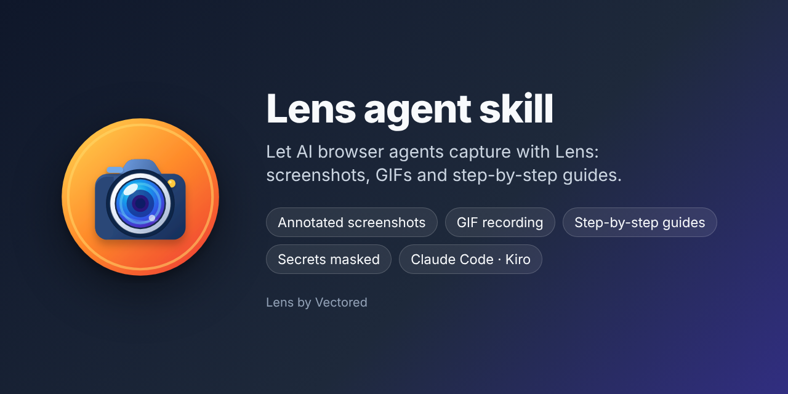

# Lens agent skill

Teaches AI browser agents, such as Claude in Chrome, to capture with the
[Lens by Vectored](https://docs.vectored.dev/lens/support.html) Chrome
extension. The agent can:

- take screenshots of a region and annotate them with boxes, arrows, text or blur;
- record GIFs of a flow;
- record step-by-step guides with one screenshot per click, then export them as
  Markdown, HTML or a bundle, check that each step still matches the page, or
  replay them in Guide Mode;
- find secrets on screen and mask them before anything is captured; the agent
  is told what and where, never the value;
- file everything into a Lens project, and pick up the saved file afterwards.

## Install

- **Claude Code:** `/plugin marketplace add openAPI-Studio/lens-skills`, then `/plugin install lens@lens-skills`
- **Kiro:** Powers → Add Custom Power → Import power from GitHub → `https://github.com/openAPI-Studio/lens-skills`
- **Any agent:** copy `skills/lens-capture-agent/` into the agent's skills folder.

## Requirements

- Lens with **Options > Allow browser agents to drive Lens** turned on. It is
  off by default. While it is on, pages you open can ask Lens to capture that
  page, so turn it on only when you use an agent.
- An agent that can run scripts in the page, such as Claude in Chrome.

## Privacy

The skill collects nothing. Lens keeps captures on your device and in folders
you link. The agent bridge only gives a page data about captures and guides
taken from that same site, and reports secrets by label and position without
their values.

Privacy Policy: https://docs.vectored.dev/lens/privacy.html

## Source

Published from the Lens repository's `skills/` folder. The command reference
is `skills/lens-capture-agent/references/commands.md`.

The layout follows the [Agent Plugins](https://agent-plugins.org) spec, which
Kiro reads (`plugin.json` and `skills/` at the root), alongside the Claude Code
plugin files in `.claude-plugin/`. `icon.png` is the skill's image.

## Support

- Support page: https://docs.vectored.dev/lens/support.html
- Issues: https://github.com/openAPI-Studio/lens-skills/issues

## License

MIT. The skill files in this repository are MIT-licensed. Lens itself is
proprietary software under its own license: https://docs.vectored.dev/lens/license.html
